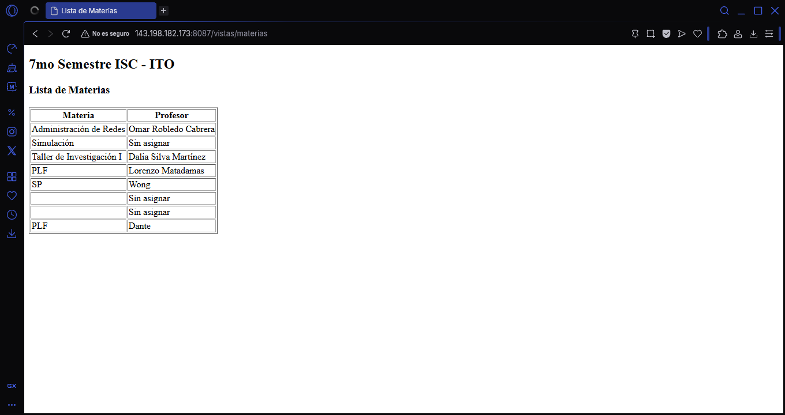
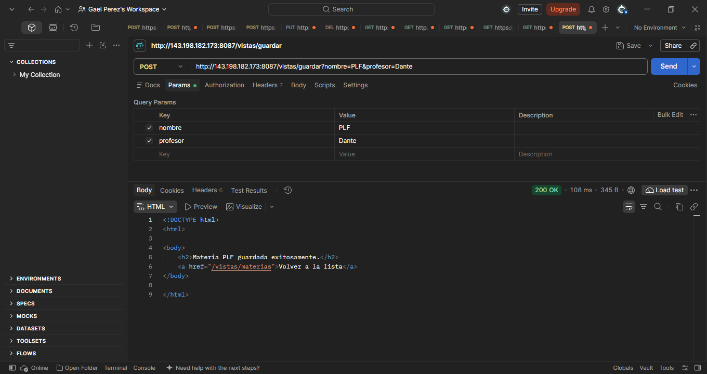
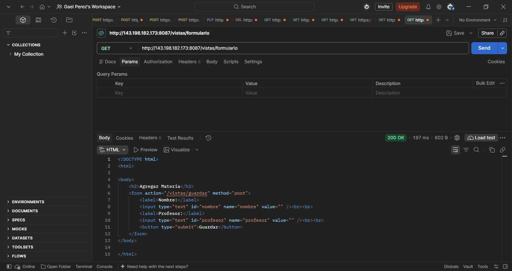
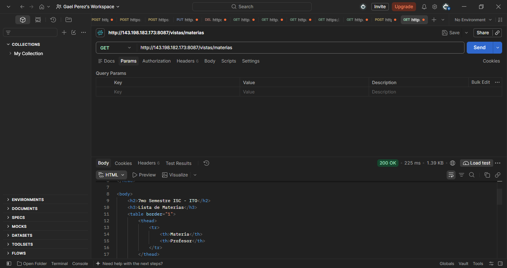
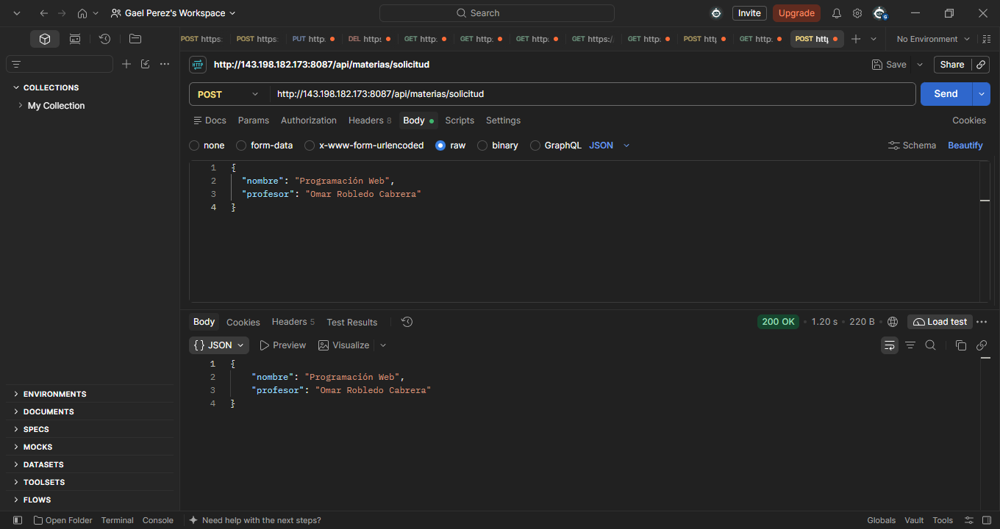

# OPGFact2_t4 - Actividad 2:  Vistas con Thymeleaf, DTOs y Manejo de Peticiones

- **Estudiante:** Gael Fernando Ortíz Pérez
- **No. de Control:** 23161060
- **Semestre:** 7mo Semestre ISC - Instituto Tecnológico de Oaxaca (ITO)
- **Materia:** Programación Web
- **Puerto configurado:** `8087`

---

## 1. Descripción General

Este proyecto corresponde a la **Actividad 2 (`OPGFact2_t4`)**, construida sobre una copia independiente del proyecto de la Actividad 1 (`OPGFact1_t4`), implementando:
- El **patrón Modelo-Vista-Controlador (MVC)** con **Spring Boot** y **Thymeleaf** para el renderizado de vistas HTML del lado del servidor.
- Estructuración de datos mediante la clase DTO **`MateriaDTO`**.
- Manejo de parámetros con **`@ModelAttribute`**, **`@RequestParam`** y **`@PathVariable`**.
- Lectura e inyección de propiedades personalizadas desde `application.properties` utilizando **`@Value`**.
- Peticiones **`POST` REST** recibiendo objetos JSON mediante **`@RequestBody`** probadas en Postman.
- Despliegue independiente en VPS en un puerto distinto (`8087`) sin afectar la instancia de la Actividad 1.

---

## 2. Estructura del Proyecto (MVC y REST)

- **Modelo / DTO:**
  - `src/main/java/models/dto/MateriaDTO.java`: Clase DTO con los atributos `nombre` y `profesor`.
  - `src/main/java/models/Empleados.java`: Modelo conservado de la Actividad 1.
- **Controladores:**
  - `src/main/java/com/ito/OPGFact2_t4/controllers/MateriaController.java`: Controlador MVC (`@Controller`, ruta base `/vistas`) que retorna vistas Thymeleaf.
  - `src/main/java/com/ito/OPGFact2_t4/controllers/MateriaRestController.java`: Controlador REST (`@RestController`, ruta base `/api/materias`) que recibe y retorna JSON.
  - `src/main/java/com/ito/OPGFact2_t4/controllers/InfoController.java` y `DatosRestController.java`: Controladores originales de la Actividad 1.
- **Vistas (Plantillas Thymeleaf en `src/main/resources/templates/`):**
  - `lista.html`: Muestra la tabla de materias recorriéndola con `th:each` y el título inyectado con `@Value`.
  - `formulario.html`: Formulario HTML vinculado a `MateriaDTO` con `th:object` y `th:field`.
  - `exito.html`: Vista de confirmación al procesar el formulario con `@ModelAttribute`.
  - `busqueda.html`: Vista que muestra el término recibido mediante `@RequestParam`.
  - `detalle.html`: Vista que muestra el ID recibido mediante `@PathVariable`.

---

## 3. Evidencias y Capturas de Pantalla

### 3.1. Vista con el listado de elementos (`Model`, `th:each` y `@Value`)
- **Endpoint:** `GET http://143.198.182.173:8087/vistas/materias`
- **Descripción:** Muestra la propiedad `config.semestre` leída desde `application.properties` con `@Value("${config.semestre}")` y recorre la lista de `MateriaDTO` utilizando la directiva `th:each`, aplicando un operador ternario cuando la materia no tiene profesor asignado (`'Sin asignar'`), se logran apreciar unas inserciones raras, las cuales son resultados de las pruebas con POSTMAN.



---

### 3.2. Formulario con `@ModelAttribute`
- **Endpoints:**
  - `GET http://143.198.182.173:8087/vistas/formulario` (muestra el formulario vacío)
  - `POST http://143.198.182.173:8087/vistas/guardar` (recibe los datos con `@ModelAttribute MateriaDTO` y los agrega a la lista)
- **Descripción:** Captura el nombre de la materia y el profesor desde el formulario HTML, los procesa con `@ModelAttribute`, muestra el mensaje de confirmación en `exito.html` y agrega el registro a la tabla de materias.




---

### 3.3. Endpoint con `@RequestParam`
- **Endpoint:** `GET http://143.198.182.173:8087/vistas/buscar?q=Simulacion`
- **Descripción:** Recibe el parámetro de consulta `q` en la URL mediante `@RequestParam(name = "q", required = false)` y lo renderiza en la vista `busqueda.html`.


---

### 3.4. Endpoint con `@PathVariable`
- **Endpoint:** `GET http://143.198.182.173:8087/vistas/materias/1`
- **Descripción:** Extrae el identificador `{id}` directamente de la ruta usando `@PathVariable Long id` y lo muestra en la vista `detalle.html`.

---

### 3.5. Petición `POST` REST probada en Postman / Bruno (`@RequestBody` con DTO)
- **Endpoint:** `POST http://143.198.182.173:8087/api/materias/solicitud`
- **Body (JSON) enviado:**
  ```json
  {
    "nombre": "Programación Web",
    "profesor": "Omar Robledo Cabrera"
  }
- **Descripción:** El controlador `MateriaRestController` recibe el cuerpo JSON mediante `@RequestBody` MateriaDTO y devuelve el objeto deserializado en formato JSON con código de estado `200 OK`.


---

## 4. Cuestionario de la Actividad

### a) ¿Qué es el patrón MVC y cómo se ve reflejado en tu proyecto (qué parte es el Modelo, cuál la Vista y cuál el Controlador)?
El patrón **MVC (Modelo-Vista-Controlador)** es un patrón de arquitectura de software que separa los datos, la lógica de control y la interfaz de usuario en tres componentes independientes:
- **Modelo:** Representa la estructura de datos e información que maneja la aplicación. En este proyecto se refleja en la clase [`MateriaDTO`](src/main/java/models/dto/MateriaDTO.java) (y [`Empleados`](src/main/java/models/Empleados.java)), así como el objeto `org.springframework.ui.Model` que transporta los atributos hacia las vistas.
- **Vista:** Es la capa encargada de presentar los datos al usuario final. En este proyecto está conformada por las plantillas HTML con **Thymeleaf** ubicadas en `src/main/resources/templates/` (`lista.html`, `formulario.html`, `exito.html`, `busqueda.html`, `detalle.html`).
- **Controlador:** Es el intermediario que recibe las peticiones HTTP del usuario, procesa los parámetros o datos del modelo y decide qué vista renderizar. En este proyecto se refleja en [`MateriaController`](src/main/java/com/ito/OPGFact2_t4/controllers/MateriaController.java) (e [`InfoController`](src/main/java/com/ito/OPGFact2_t4/controllers/InfoController.java)).

### b) ¿Para qué sirve una clase DTO y por qué no simplemente usar la entidad directamente en la vista o en la petición?
Un **DTO (Data Transfer Object)** es un objeto diseñado específicamente para transportar datos entre capas o a través de la red (entre el cliente/vista y el servidor). No se debe exponer la entidad de base de datos directamente porque:
1. **Seguridad:** Evita exponer campos sensibles o internos de la entidad (como contraseñas, metadatos internos o relaciones completas) y previene vulnerabilidades de asignación masiva (*Mass Assignment*).
2. **Desacoplamiento:** Permite cambiar la estructura interna de la base de datos o de las entidades sin romper las vistas ni los contratos de la API.
3. **Eficiencia:** Transfiere únicamente los campos necesarios para una vista o petición específica (`nombre` y `profesor` en `MateriaDTO`), reduciendo el tamaño de la carga útil.

### c) ¿Qué diferencia hay entre `@ModelAttribute` y `@RequestBody`? ¿Cuándo usarías cada uno?
- **`@ModelAttribute`:** Vincula parámetros enviados desde formularios HTML (`application/x-www-form-urlencoded` o `multipart/form-data`) o parámetros de consulta directamente a un objeto Java y lo expone en el `Model` de la vista. Se usa en **controladores MVC tradicionales (`@Controller`)** cuando se trabaja con formularios renderizados del lado del servidor (como en Thymeleaf en `POST /vistas/guardar`).
- **`@RequestBody`:** Deserializa el cuerpo crudo de una petición HTTP (generalmente en formato **JSON** o XML) hacia un objeto Java utilizando convertidores como Jackson. Se usa en **controladores REST (`@RestController`)** para comunicar APIs consumidas por clientes externos, aplicaciones móviles, SPAs o herramientas como Postman/Bruno (como en `POST /api/materias/solicitud`).
